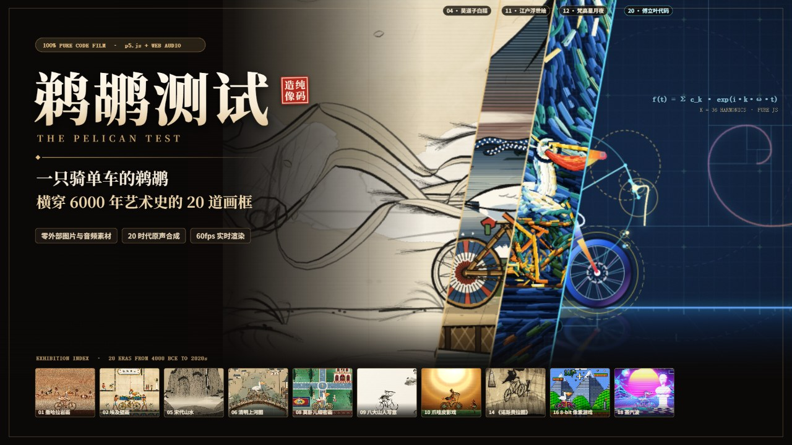

# 《鹈鹕测试》 Pelican Test



> 「人类自古以来就痴迷于画鹈鹕骑自行车。——早在自行车被发明之前。」  
> ——《鹈鹕骑行艺术通史》，卷一（虚构文献）

**《鹈鹕测试》（Pelican Test）** 是一支时长 `2:17`（`137.0s`，`120 BPM`，`1920×1080 @ 60fps`）的 **100% 纯代码实时生成动画短片**。

全片不依赖任何外部位图贴图或录音采样——一只由双骨骼解析逆运动学（2-Bone Analytical IK）驱动的骑自行车鹈鹕，沿着一条跨越六千年的连续道路，依次穿过 **20 道不同历史时期与媒介材质的画框**；与此同时，内置的 Web Audio API 程序化合成器将同一条原创主旋律实时映射为 20 种时代调式与器乐音色。

---

## 核心特性

- **确定性纯函数帧调度 `renderAt(t)`**：任意时刻 `t ∈ [0, 137.0]` 均为无状态确定性渲染，既支持浏览器 `60fps` 实时交互播控，也支持逐帧离线无损导出。
- **20 时代馆藏级程序化美术（`p5.js` + `p5.brush`）**：涵盖矿物岩画、纸草打格壁画、汉画像石拓片、吴道子白描长卷、北宋巨碑山水、汴京虹桥界画、树皮纸古抄本、莫卧儿细密画、八大山人写意水墨、爪哇皮影戏、江户木版浮世绘、厚涂星空、表现主义木刻与默片光影、P1 荧光示波器、四声道 8-bit 像素、千禧即时通讯窗口、降速磁带蒸汽波、竖屏短视频界面，以及 36 阶复数傅立叶本轮（`Σ c_k · exp(i·k·ω·t)`）几何代码美学。
- **媒介专属装裱与跨框微物理**：7 大装裱体系（包括唐宋连卷隔水绫裱与骑缝藏书印）配合 20 处跨框局部材质微物理（拓片墨粉震落、清风解带、皮影油灯火星、阴极射线电弧击穿等）。
- **零采样 Web Audio 原创音轨**：基于 `OfflineAudioContext` 在浏览器端毫秒级合成全片双声道母带（含传统调式映射、时代拟音音效，以及 `#18 蒸汽波` 的升调合成再 `0.7937×` 磁带降速抖晃链路）。

---

## 20 时代画框索引

| # | 年代 | 版块 | 视觉媒介与音乐调式 |
| :-: | :--- | :--- | :--- |
| `01` | 约前 4000 | 撒哈拉岩画 | 塔西里砂岩赭石矿物壁画 · 原始五声手鼓与母音吟唱 |
| `02` | 约前 1300 | 埃及壁画 | 纸草朱砂网格与侧面律定格 · Hijaz 调式竖琴与叉铃 |
| `03` | 约 100 | 汉画像石拓片 | 凿石肌理与乌金拓片车马队列 · 宫调双音青铜编钟 |
| `04` | 约 750 | 唐代白描 | 硬黄纸《送子天王图》吴带当风 · 燕乐琵琶轮指与筚篥 |
| `05` | 约 1000 | 宋代山水 | 致敬《溪山行旅图》斧劈皴巨嶂 · 徵调古琴泛音与松风 |
| `06` | 约 1100 | 清明上河图 | 汴水虹桥界画市井百态 · 汴京竹笛、笙与板鼓 |
| `07` | 约 1300 | 玛雅古抄本 | 树皮纸灰泥折页与历法神圣文字 · 陶笛与木缝鼓 |
| `08` | 约 1620 | 莫卧儿细密画 | 四分花园青金石金箔边框 · Yaman 拉格西塔琴与塔布拉 |
| `09` | 约 1700 | 八大山人写意 | 宣纸泼墨留白与孤傲翻白眼水鸟 · 洞箫孤韵与竹木单音 |
| `10` | 约 1750 | 爪哇皮影戏 | 椰油灯白幕透光镂空牛皮偶 · Slendro 五音甘美兰铜琴 |
| `11` | 1830s | 江户浮世绘 | 东海道套色木版画与疾风吹笠 · 都节音阶三味线与尺八 |
| `12` | 1889 | 梵高《星月夜》 | 普鲁士蓝与铬黄厚涂漩涡星云轮 · 夜曲弦乐震音与竖琴琶音 |
| `13` | 1893 | 蒙克《呐喊》 | 血色峡湾透视木桥与失谐声浪 · 半音滑奏尖啸弦乐 |
| `14` | 1922 | 《诺斯费拉图》 | 表现主义斜角拱廊与烛台长影 · 默片酒馆钢琴与管风琴 |
| `15` | 1958 | 示波器电子艺术 | Tektronix P1 绿磷余晖与李萨如畸变 · 纯正弦 FM 实验电子 |
| `16` | 1985 | 8-bit 像素游戏 | `250×250` 硬件调色板横版跳跃 · 四声道方波/三角波芯片音乐 |
| `17` | 2001 | 千禧年聊天窗口 | 经典蓝题栏桌面 UI 与抖动弹窗 · General MIDI 合成音色 |
| `18` | 2012 | 蒸汽波 | 落日网格、石膏胸像与 VHS 磁带雪花 · 升四度合成后 `0.7937×` 磁带降速 |
| `19` | 2020 | 竖屏短视频 | `9:16` 沉浸竖屏信息流与飘屏爱心 · 现代电子流行节拍 |
| `20` | 2020s | 代码美学 | 36 阶复数傅立叶本轮绘形与三角网格 · 泛音列精准叠加扫频 |

---

## 快速开始

### 1. 本地实时预览（交互播放器）

本项目运行期零构建依赖，任意静态文件服务器即可直接打开：

```bash
pnpm install
pnpm serve
# 浏览器访问 http://127.0.0.1:4173
```

**播放器快捷键**：
- `Space` / 单击画面：播放 / 暂停
- `←` / `→`：前后逐拍微调 `0.5s`（按住 `Shift` 步进 `2.0s`）
- `M`：静音 / 取消静音
- `F`：全屏切换

### 2. 构建静态发布包（如部署至 Cloudflare Pages）

```bash
pnpm build
```

`tools/build-cf.mjs` 会生成纯净静态产物至 `dist/`（已内置子集化 `.woff2` 字体，整包仅约 `5.6 MiB`，单文件最大 `< 1 MiB`）：
- **Build command**: `node tools/build-cf.mjs`
- **Build output directory**: `dist`

### 3. 离线渲染 1080p 60fps 无损成片与封面（开发工具链）

需本机运行开启远程调试端口（默认 `http://127.0.0.1:19222`）的 Chromium/Chrome 与 `ffmpeg`：

```bash
# 单帧/多帧截屏检查
pnpm shot 73.5 out/starry_test.png

# 导出 16:9 与 4:3 视频封面
pnpm cover

# 离线渲染 48kHz 双声道 WAV 音轨 + 60fps PNG 序列并封装 MP4
node tools/render-audio.mjs
pnpm render
pnpm encode
```

---

## 目录结构

```text
├── index.html              # 交互式全片播放器入口
├── gallery.html            # 20 时代静态分镜检视页（开发辅助）
├── render.html             # 1920×1080 离屏逐帧渲染宿主
├── public/
│   ├── fonts/              # 开源字体（.woff2 子集化字体 + .ttf 原件）
│   ├── vendor/             # p5.js (2.3.4) 与 p5.brush (3.0.0)
│   └── style.css           # 字体声明与播放器样式
├── src/
│   ├── main.js             # 纯函数总控帧调度 renderAt(t) 与 UI 绑定
│   ├── beat/               # 120 BPM 音乐时钟、时间轴与滑轨摄影机
│   ├── rig/                # 鹈鹕 + 自行车双骨骼解析 IK 模型
│   ├── kit/                # 离屏画布池、水墨纸张、7 系装裱与跨框微物理
│   ├── scenes/             # Intro + 20 个时代独立渲染模块 + Outro 发布会
│   └── audio/              # Web Audio 调式映射、器乐合成、拟音与蒸汽波磁带链路
└── tools/                  # 静态服务、CDP 截帧、封面生成、音频导出与静态打包脚本
```

---

## 开源许可与致谢

- 本仓库源代码采用 [MIT License](./LICENSE) 开源。
- 第三方运行时组件与开源字体许可声明详见 [THIRD_PARTY_NOTICES.md](./THIRD_PARTY_NOTICES.md)。
